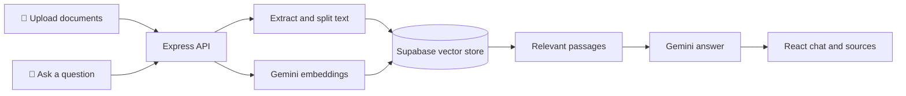

<div align="center">

# RAG System

### Ask questions. Get answers from your documents.

An Arabic- and English-friendly document assistant powered by retrieval-augmented generation.

<p>
  
  
  
  
  
  
</p>

</div>

## ✨ What it does

Upload PDF, TXT, or Markdown documents and ask questions in natural language. The system searches your indexed files for relevant passages and uses Google Gemini to generate an answer grounded in those passages, with source information when available.

The interface supports Arabic and English, adapts to mobile and desktop screens, keeps a separate conversation session for each browser, and scrolls chat messages inside the conversation panel without scrolling the whole page. It also shows the submitted question immediately and displays a chatbot "thinking" indicator while waiting for the answer.

## 🖼️ How it works



## 🧰 Built with

| Area | Technologies |
|---|---|
| Frontend | React 19, Vite 8, Tailwind CSS 4 |
| Backend | Node.js, Express 5 |
| AI and orchestration | LangChain.js, Google Gemini (`gemini-3.5-flash-lite`) |
| Embeddings | Google Gemini (`gemini-embedding-001`) |
| Vector database | Supabase, PostgreSQL, `pgvector` |
| File ingestion | LangChain text splitters and PDF loader |

## ✅ Requirements

- **Node.js:** `^20.19.0` or `>=22.12.0` (required by the installed Vite version)
- npm
- A Google AI API key with access to Gemini chat and embeddings
- A Supabase project with PostgreSQL and the `pgvector` extension

## 🚀 Run locally

### 1. Install packages

Run from the project root:

```bash
npm install
```

### 2. Configure environment variables

Copy `.env.example` to `.env` in the project root and fill in your credentials:

```env
AI_API_KEY=your_google_ai_api_key
SUPABASE_URL=https://your-project.supabase.co
SUPABASE_SECRET_KEY=your_supabase_secret_key
PORT=3000
FRONTEND_URL=http://localhost:5173
```

`AI_API_KEY`, `SUPABASE_URL`, and `SUPABASE_SECRET_KEY` are required. `PORT` and `FRONTEND_URL` are optional and default to `3000` and `http://localhost:5173`.

> **Keep your credentials private.** Never add `.env` to Git or put server secrets in frontend variables.

For local development, the Vite server proxies API requests to `http://localhost:3000`; `VITE_API_URL` can remain empty. If you need a frontend environment file, create `client/.env`:

```env
VITE_API_URL=
```

### 3. Prepare Supabase

The application expects a `documents` table and a `match_documents` search function. Run this SQL in the Supabase SQL Editor:

```sql
create extension if not exists vector;

create table if not exists public.documents (
  id bigint generated by default as identity primary key,
  content text,
  metadata jsonb,
  embedding vector(3072)
);

create or replace function public.match_documents (
  query_embedding vector(3072),
  match_count int default null,
  filter jsonb default '{}'
)
returns table (
  id bigint,
  content text,
  metadata jsonb,
  similarity float
)
language plpgsql
as $$
begin
  return query
  select
    documents.id,
    documents.content,
    documents.metadata,
    1 - (documents.embedding <=> query_embedding) as similarity
  from public.documents
  where documents.metadata @> filter
  order by documents.embedding <=> query_embedding
  limit match_count;
end;
$$;
```

The `3072` dimensions match the default output of `gemini-embedding-001`. If you change the embedding model or dimensions, update the table and function to match.

### 4. Start the backend and frontend

Open two terminals in the project root:

```bash
npm run dev:backend
```

```bash
npm run dev:frontend
```

Open the frontend URL printed by Vite, usually **http://127.0.0.1:5173/**. The backend listens on **http://localhost:3000** by default.

### 5. Build the frontend

```bash
npm run build:frontend
```

The production files are written to `client/dist`. This builds the frontend only; deploy the backend separately.

## 📖 Using the app

1. Upload one or more documents from the documents panel.
2. Wait for the upload and indexing to finish.
3. Ask a question in the chat. Press **Enter** to send or **Shift + Enter** to insert a new line.
4. Your question appears immediately, followed by a chatbot thinking indicator.
5. Read the answer and check the listed source filenames.
6. Use the chat scrollbar to review older messages; the page stays fixed while scrolling inside the conversation on desktop.
7. Delete documents or clear the current conversation using the controls.

**Upload limits:** `.pdf`, `.txt`, and `.md` files; up to **5 MB per file** and **20 files per request**.

## 🔌 API overview

The default API base URL is `http://localhost:3000`.

| Method | Endpoint | Purpose |
|---|---|---|
| `POST` | `/chat` | Ask a question. JSON body: `{ "question": "...", "sessionId": "..." }` |
| `DELETE` | `/chat/history/:sessionId` | Clear the in-memory history for a session |
| `GET` | `/documents` | List uploaded documents |
| `POST` | `/documents` | Upload files as `multipart/form-data` using the `documents` field |
| `DELETE` | `/documents/:fileName` | Delete a document |

The chat response contains an `answer` and a `sources` array. The API applies per-IP rate limits and returns `429` when a limit is exceeded.

## 🗂️ Project layout

```text
client/                 React application and Vite configuration
  src/
    api.js              Frontend API service
    App.jsx             Chat and document management UI
    main.jsx            React entry point
    style.css           Application styles
src/
  controllers/               Chat and document API controllers
  utils/                AI, prompts, Supabase, uploads, and session helpers
  documents/            Uploaded source files
  server.js             Express server entry point
  splitter.js           Document loading, splitting, and indexing
.env.example            Backend environment variable template
package.json            Dependencies and development scripts
```

## ⚠️ Notes

- Original uploaded files are stored on the backend filesystem in `src/documents`; make this directory persistent in production.
- Document chunks and embeddings are stored in Supabase.
- The chat response uses up to two relevant document chunks and limits the provided context to reduce model input tokens.
- LLM responses are cached in memory when the same request and prompt are repeated during the backend process lifetime.
- The UI uses separate user and chatbot icons, supports light and dark themes, and adapts the conversation and document panels for desktop and mobile screens.
- Backend conversation history is held in memory: up to 10 messages per session, a 24-hour inactivity expiry, and 1,000 sessions maximum. Restarting the backend clears it.
- The browser stores its session ID and up to 10 displayed messages in `localStorage`. Clearing the browser's site data starts a new browser session.
- In production, set `FRONTEND_URL` to the deployed frontend origin. If frontend and backend are on different origins, set `VITE_API_URL` before building the frontend.

## 📌 Project summary

RAG System is a full-stack document assistant that combines a responsive React chat interface with an Express API, Gemini language and embedding models, and Supabase vector search. It turns uploaded files into searchable knowledge, retrieves relevant passages for each question, and returns a concise answer with source references. It is designed as a straightforward starting point for building retrieval-augmented applications, with Arabic and English support and a simple local development workflow.
